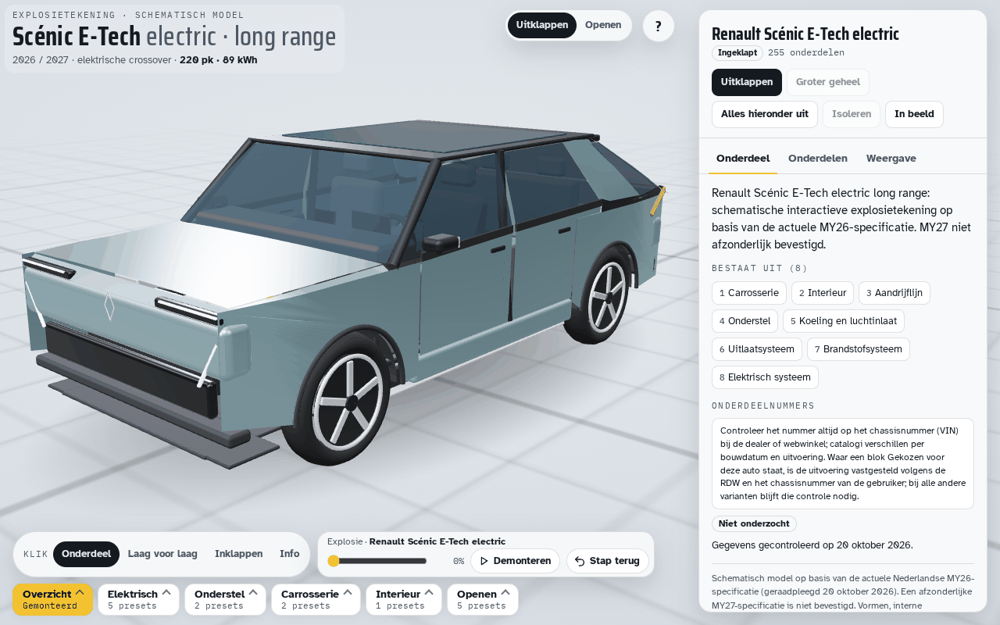

# Scénic E-Tech electric explosietekening

Interactief, procedureel 3D-model van de elektrische Renault Scénic, op de actuele generieke laag van [laguna3](https://github.com/rvd-gmpplus/laguna3) (`main`, `321661674a56d3fa96d91b98301d441b3d4285af`, versie 17). De 49 generieke bestanden blijven byte voor byte gelijk. Herkomst: [FRAMEWORK](FRAMEWORK).

De gekozen uitvoering is de actuele Nederlandse **MY26 long range met 89 kWh en 220 pk**, als basis voor de gevraagde 2026/2027-versie. Renault vermeldt in de huidige brochure ook de nieuwe 67 kWh comfort range. Er is geen afzonderlijke MY27-specificatie bevestigd; het model claimt geen toekomstige facelift of uitrusting. Zie [specificaties en bronnen](docs/specificaties-en-bronnen.md).



## Starten

Open `index.html` in een moderne browser, of serveer de map met `python3 -m http.server 8000`. De pagina gebruikt three.js r147 via jsDelivr en Google Fonts. De klassieke three.js-versie is bewust gelijk aan het bronframework; een overstap naar ES-modules is een afzonderlijke frameworkmigratie.

Slepen draait de camera, scrollen zoomt. Klik op groepen om ze uit te klappen. Kies de modus Openen om motorkap, vier portieren, achterklep en laadklep te bedienen. Solarbay is vast glas en schuift niet open. De helpknop `?` beschrijft toetsenbord- en aanraakbediening.

Er zijn 21 presets, waaronder `?preset=battery`, `?preset=engine`, `?preset=charging`, `?preset=interior` en `?preset=openAll`. Zoek op onderdeelnaam via de onderdelenlijst. De accu bevat twaalf **illustratieve** blokken; het werkelijke moduleaantal is niet vastgesteld. Er zijn geen verzonnen onderdeelnummers.

## Bouwen en controleren

```sh
bash tools/setup.sh
python3 build.py --lint
python3 build.py
python3 tools/framework.py check
python3 tools/pncheck.py --tree
bash tools/orkestratie/finaltests.sh uit/volledig
```

`src/` bevat alle geometrie; er zijn geen externe modelbestanden. `auto.json` bevat alle voertuigteksten. Het framework hanteert acht vaste hoofdgroepen: de legacy-groepen Uitlaatsysteem en Brandstofsysteem bevatten uitsluitend een informatienoot dat deze systemen niet aanwezig zijn. Het model bevat geen tank, uitlaat of verbrandingsmotor.

## GitHub en overdracht

Repository: [rvd-gmpplus/scenic-e](https://github.com/rvd-gmpplus/scenic-e). De actuele kwaliteitspoorten staan in [teststatus.md](docs/teststatus.md). Een eerste schematische versie is geen gevalideerd Renault-CAD-model.

Bij overdracht via een Git-bundle: `git clone scenic-e.bundle scenic-e`. In die kloon wijst `origin` eerst naar het bundlebestand; gebruik `git remote set-url origin https://github.com/rvd-gmpplus/scenic-e.git` om verder te werken met GitHub.

## Nauwkeurigheid en verificatie

Dit is een schematische technische visualisatie, geen Renault-CAD, homologatiemodel of montagehandleiding. Gepubliceerde hoofdmaten begrenzen het model; paneelprofielen, scharnierhoeken, interne geometrie en componentplaatsen zijn geschat. De silhouetcontrole bewaakt een ontwerpreferentie, geen onafhankelijk gemeten fotoreferentie. Zie [bouwcontract](docs/contract.md), [teststatus](docs/teststatus.md) en [cijfers](docs/cijfers.md).

MIT-licentie, met behoud van de auteursvermelding van het bronframework. Renault- en Scénic-namen duiden het afgebeelde voertuig aan; dit is geen officieel Renault-product.
